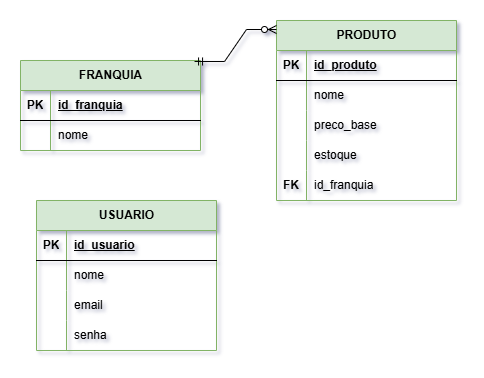

## MER - Geek Store

### Entidades e atributos

🎮 FRANQUIA
- id_franquia (PK)
- nome

🕹️ PRODUTO
- id_produto (PK)
- nome
- preco_base
- estoque 
- id_franquia (FK)

🧑‍💻 USUARIO 
- id_usuario (PK)
- nome
- email
- senha

### Relacionamentos
- 1 FRANQUIA possui N PRODUTOS (1:N)
- 1 PRODUTO pertence a 1 FRANQUIA

### RN's
- Se estoque = 1 → status = "LAST ITEM" e preço exibido = preco_base × 1,10 (REQ05 e REQ11)
- Se estoque > 1 → status = "-" e preço a ser exibido = preco_base

